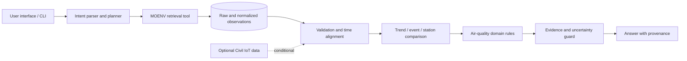

# DESIGN.md — Taiwan Air Quality Evidence Agent

> Living design document for the Proposal phase. Any unverified choice is marked provisional.

## 1. Problem

Users need to interpret air-quality observations by place and time, understand which pollutant and stations support the interpretation, and see when the evidence is incomplete. The project proposes an evidence-grounded Domain AI Agent for public Taiwan air-quality data.

## 2. Requirements

### Functional

- Accept a supported location/station, time range, pollutant, and analysis question.
- Retrieve official hourly AQI and pollutant records.
- Validate freshness, missingness, duplicate records, units, and timestamps.
- Produce trend, event, or station-comparison summaries.
- Show supporting station/time/value/source evidence and uncertainty.
- Decline unsupported causal or individualized medical conclusions.

### Non-functional

- Reproducible data processing and evaluation.
- Traceable links from response claims to source records.
- Graceful handling of missing, stale, or conflicting observations.
- Documented API limits, data license, and citation requirements.

## 3. Architecture

## 4. Components

| Component | Responsibility | Input | Output |
|---|---|---|---|
| Intent parser/planner | Identify query type, place, period, pollutant; select tools | User question | Structured query plan |
| MOENV retrieval | Fetch hourly AQI/pollutant records or archived extracts | Stations and time window | Raw records plus source metadata |
| Optional IoT retrieval | Fetch fine-resolution sensor observations if API and licensing are suitable | Sensor/station identifiers and time window | Raw sensor observations |
| Data validator | Normalize, validate, flag missingness/staleness/duplicates | Raw records | Validated observations and quality flags |
| Analytics engine | Trend/event detection and station comparisons | Validated observations | Numeric results and baseline comparison |
| Domain knowledge | Apply pollutant, time-window, and interpretation rules | Numeric results | Qualified interpretation |
| Grounding guard | Ensure claims are supported by evidence; expose uncertainty | Interpretation and source records | Claims with provenance |
| Response layer | Render concise, sourced answer | Grounded claims | User-facing response |

## 5. Data

### Primary source

- Ministry of Environment historical dataset **AQX_P_488**, hourly AQI; fields include station, county, AQI/status, major pollutant, SO2, CO, O3, PM10, PM2.5, NO2/NOx/NO, wind speed/direction, publication time, coordinates, and station ID. The platform lists monthly historical archives.
- Dataset page: https://data.moenv.gov.tw/dataset/detail/aqx_p_488
- Current dataset **AQX_P_432** is available for a live-data demonstration: https://data.moenv.gov.tw/dataset/detail/aqx_p_432
- The platform documents API retrieval, but historical API access/key requirements and query limits must be confirmed. Keep credentials out of source control.

### Candidate secondary source

- Ministry of Environment / Civil IoT air-pollution sensors report PM2.5, temperature, relative humidity, and other sensor observations at approximately three-minute intervals.
- Overview: https://env.moenv.gov.tw/en/Issue/Index/53b6ae55-bb69-449e-953e-01c2330ca3b8
- Integration is conditional on verifying API access, station mapping, historical retention, and quality metadata. The primary proposal does not depend on it.

### Data handling

- Preserve raw downloaded data and retrieval timestamp.
- Normalize time zone explicitly (Taiwan local time, UTC+8) and units.
- Preserve source station IDs; do not join stations by name alone.
- Flag absent, sentinel, stale, and duplicate records rather than silently treating them as valid.
- For the 2026 AQX_P_488 archives, normalize bilingual duplicates by `(SiteId, DataCreationDate)`. Fill missing fields from another localized copy only when non-missing numeric values agree; isolate the entire key if numeric values conflict. Recover a missing SiteId only from a unique match on county and exact coordinates; otherwise exclude it and log it.
- Do not claim that nearby stations represent a user's exact exposure.

## 6. AI / Analytics

The minimum viable system is tool-using and analytics-driven. Candidate techniques include robust descriptive statistics, threshold/persistence event rules, time-series baselines, and (only if scope/data permit) a small forecast or anomaly model. A language model may parse questions and render verified tool outputs, but must not generate measurement values. Model choice and prompt strategy remain provisional.

## 7. Domain Knowledge

Initial knowledge areas: AQI and pollutant-specific interpretation; averaging windows; station representativeness; time alignment and data freshness; meteorological influence on dispersion; low-cost sensor calibration, humidity effects, and transferability; uncertainty communication. Every operational rule must map to an authoritative or peer-reviewed reference in the final version.

## 8. Algorithm

1. Parse the query into intent, station/place, time window, and pollutant.
2. Retrieve records and source metadata.
3. Validate units, timestamps, duplicate records, missingness, and freshness.
4. Return a data-gap response if evidence is inadequate.
5. Run the requested trend, event, or station-comparison analysis.
6. Compare with a simple baseline when evaluating an algorithmic prediction/detection claim.
7. Apply domain constraints and attach record-level provenance.
8. Generate and verify the response; qualify unsupported inferences.

## 9. Implementation Mapping (planned)

| Design component | Planned implementation |
|---|---|
| Retrieval | Python HTTP client for MOENV API and/or archived downloads |
| Data normalization | pandas DataFrame with documented schema and Taiwan timezone handling |
| Quality checks | Explicit validation functions and quality flags |
| Analytics | pandas/scikit-learn baseline methods, subject to final scope |
| Agent orchestration | Lightweight deterministic router/tool calls first; LLM integration only if available and explainable |
| UI | CLI or small web dashboard, to be selected after data feasibility check |
| Evaluation | Reproducible scripts/notebooks and a labeled query/event set |

## 10. Evaluation and Results

Planned: data completeness and freshness; event/trend metrics against transparent baselines; evidence-grounding audit; edge cases for stale/missing/conflicting data. No results are available at Proposal stage. Record datasets, split strategy, baselines, metrics, and limitations here after experiments.

## 11. Limitations and Risks

- Historical files are listed, but the reproducible download/API pathway, rate limits, and API key requirements still need confirmation.
- Official station observations do not equal personal exposure at every location.
- Low-cost sensor observations may have calibration, humidity, siting, or drift issues.
- Event labels can be subjective; define them before computing classification metrics.
- Air-quality summaries do not support individualized diagnosis or causal attribution by themselves.
- A model trained in one city, season, or sensor network may not transfer elsewhere.

## 12. How to Run

Not implemented yet. Once the data source and stack are confirmed, document environment setup, credential configuration, data retrieval, analysis, and demo commands here.

## 13. References

- MOENV historical AQI dataset AQX_P_488: https://data.moenv.gov.tw/dataset/detail/aqx_p_488
- MOENV current AQI dataset AQX_P_432: https://data.moenv.gov.tw/dataset/detail/aqx_p_432
- MOENV air pollution sensing IoT: https://env.moenv.gov.tw/en/Issue/Index/53b6ae55-bb69-449e-953e-01c2330ca3b8
- Fang et al. (2025), DOI 10.1016/j.scitotenv.2025.180106.
- *Calibration and validation-based assessment of low-cost air quality sensors* (2025), DOI 10.1016/j.scitotenv.2025.179364.
- *Exploration of a practical approach to providing RH corrections to low cost sensor networks* (2025), DOI 10.1038/s41612-025-01115-8.
