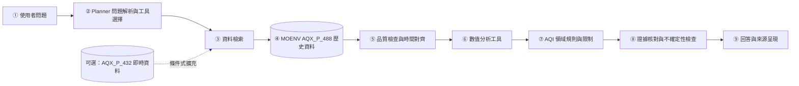
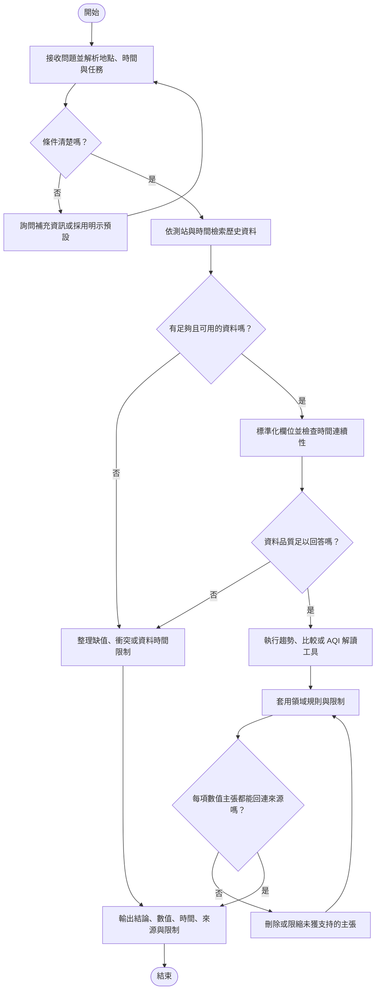

# 台灣空氣品質證據分析代理人專題提案

**英文題目：Taiwan Air Quality Evidence Agent for Traceable Local Air-Quality Analysis**
**資料盤點截至 2026 年 10 月 29 日**

## 提案摘要

本專題提議製作一個以環境部逐時空氣品質資料為依據的領域 AI Agent。使用者可詢問特定地點與時段的 AQI 變化、污染物資訊及測站差異；系統檢索原始觀測、執行可重現的數值分析，再以領域規則檢查回答，並附上測站、時間、數值與資料限制。

目前的範圍以環境部 AQX_P_488 歷史資料為主。已下載的資料涵蓋 2026 年 1 月 1 日至 10 月 29 日 16 時，共 970,296 筆原始列。可重跑的清理流程合併中英文重複列、恢復 4 筆可由縣市與座標唯一辨認的測站編號，並隔離 13 組數值衝突；整理後保留 606,137 筆、88 個測站編號。這些數字描述目前下載的資料，不代表完整年度或全台所有時段都沒有缺值。[9]

近期已有跨區域空品多代理系統 Neuro-Air，使用香港與河北的多來源資料，並以 317 個問題測試分析流程。[1] 因此，本提案不主張「第一個空品 AI Agent」或提出新的 Agent 演算法。研究問題聚焦於：在台灣 AQI 規則及環境部資料品質條件下，結合資料檢索、確定性分析與受限語言模型的 Agent，能否比一般語言模型更準確地回答地點與時段問題，並讓每項數值主張回連到來源紀錄？

預計以 60 題測試集比較三種方式：語言模型直接回答、只有確定性分析工具的結果，以及本專題的工具型 Agent。題目涵蓋趨勢、測站比較、AQI／污染物解讀，以及資料不足或超出證據範圍的情境。評估數值正確率、來源對應正確率與應拒答情境的處理正確率。Proposal 階段尚未進行 Agent 實驗，所有成效均為待驗證項目。

## 1 緒論

### 1.1 研究動機

世界衛生組織 2025 年的空氣品質科學與政策摘要指出，空污暴露對健康有重大不良影響，且與全球近八分之一的死亡相關。[13] 在台灣，環境部 AQX_P_488 提供逐時測站 AQI、主要污染物、氣象欄位、座標與測站編號，並開放歷史資料下載。[9] 這些資料可用來追查「哪個測站、何時、哪些觀測值發生變化」，但使用者仍需自行比對測站與時間、理解 AQI 所代表的污染物及平均時間，並判斷資料是否足以支持結論。

### 1.2 領域與使用者背景

本專題的主要使用者是想了解台灣特定地區空品變化的一般民眾，以及需要快速檢查資料的課堂專題使用者。環境部 AQI 以多種污染物副指標中的最大值形成測站 AQI；AQI 是重要摘要，但單一數值不會完整呈現所有污染物，也不等於個人實際吸入暴露。[10] 因此，回答在呈現 AQI 時，還需保留主要污染物、時間範圍、測站和來源資料。

### 1.3 問題定義

給定使用者指定的地點、測站或時間範圍，系統如何從公開逐時監測紀錄產生可核對的趨勢、事件或測站比較說明，並在資料不足或問題超出資料能力時明確限制回答？

### 1.4 現有方法的限制

一般資料頁面提供觀測值，但解讀者仍須自行對齊測站與時間，並處理缺值或重複紀錄。生成式模型可把問題改寫成易讀文字，卻不能單靠語言流暢度證明數字正確。近期 Neuro-Air 已提出多代理工作流程與量化驗證，但其資料涵蓋香港與河北，測試任務及領域工作流程也與台灣環境部 AQI 問答不同。[1] 台灣既有研究已探討 PM2.5 預測和 AirBox 校正，但這些研究的主要任務並非以環境部歷史 AQI 資料回答可追溯的自然語言問題。[4][5]

### 1.5 本專題的作法

本專題將 Agent 的語言理解與數值計算分開。Planner 將問題轉成明確的測站、時間窗與分析任務；資料工具取得並驗證紀錄；統計或規則工具計算趨勢和差異；AQI 領域規則限制解讀；語言模型只將已驗證的結果組織成回答。每一項數值結論都要附帶測站、時間與來源依據。系統不會根據相關性推論污染來源，也不提供個人醫療診斷。

### 1.6 預期貢獻

1. 建立一套保留原始資料、可重跑並記錄資料品質處理的 AQX_P_488 準備流程。
2. 實作可依問題呼叫資料檢索、趨勢分析、測站比較與 AQI 領域規則的 Agent 原型。
3. 建立一組針對台灣 AQI 歷史資料的可回答與不可回答問題，檢查數值與來源是否吻合。
4. 比較語言模型直接回答、確定性工具輸出與工具型 Agent，整理其失敗案例和適用範圍。

## 2 相關研究

本節將 AI／資料分析研究與空品量測領域研究各列四篇，避免只討論 LLM 或預測模型而忽略 AQI 定義、站點和感測器限制。另以環境部、EPA 與 WHO 的規範補充領域依據。

### 2.1 研究摘要表

| Ref. | 年份 | 問題 | AI 方法 | 領域知識 | 資料集 | 研究發現 | 與本專題相關的限制 |
|---|---:|---|---|---|---|---|---|
| [1] Ma et al., Neuro-Air | 2026 | 將多來源空品資料用於分析與決策支援 | LLM 協調多個角色，結合資料檢索及持續式 Python 計算環境 | 空污分析、氣象、交通、排放及環境決策 | 香港與河北資料；317 題，含 90 題可程式驗證任務 | 報告顯示多代理流程可執行多步驟分析；研究也指出來源歸因、暴露與健康判斷仍需要專業審查 | 不是台灣 AQX_P_488 任務；直接建議採用多代理會超出本專題必要範圍 |
| [2] Time-series anomaly framework | 2025 | 偵測空品時間序列異常並產生解釋 | 時間序列切片、向量檢索、鄰站 DTW／Z-score 與 LLM 說明 | 空品時序、鄰近測站一致性 | 韓國空品監測資料 | 相較切片方法，研究報告在維持召回率下將 false positive rate 降低超過 50% | 任務是異常偵測；未驗證台灣 AQI 自然語言問答或逐項來源引用 |
| [3] Yenkikar et al. | 2025 | 預測 AQI 並提供模型解釋 | Random Forest 預測，ARIMA 建模殘差，搭配 SHAP 與 expanding-window 驗證 | 污染物特徵、AQI 時序 | 印度多年 AQI 資料 | 論文報告 MSE 508.46、R² 0.94，優於文中比較基準 | 研究目標是預測；資料提供方式為向作者索取，且指標不能直接與本專題的問答正確率相比 |
| [4] Lee et al. | 2020 | 預測台灣各站 PM2.5 並分析區域及氣象差異 | Gradient boosting，以鄰近氣象站和歷史污染值預測 | 台灣地形、季風、工業排放 | 77 個空品站、580 個氣象站的逐時資料 | 台中加入電廠排放特徵後，平均 R² 由 0.58 升至 0.71，RMSE 由 8.56 降至 7.06 | 資料與研究時間較早；著重 24 小時 PM2.5 預測，不處理自然語言問答和來源追溯 |
| [5] Tzeng et al. | 2023 | 校正台灣 AirBox 空間異質的 PM2.5 讀值 | 空間變動係數模型與異質誤差估計 | 台灣 TAQMN 參考站、AirBox 低成本站、空間差異 | 台灣 2020 年逐時 EPA 與 AirBox 資料 | 論文報告 RMSE 改善約 38%–68%，並提供不確定區間 | 聚焦 PM2.5 校正；低成本感測器的結果不能直接套用到官方 AQI 站資料 |
| [6] Dong et al. | 2025 | 評估低成本空氣感測器的校正與驗證 | 線性與非線性校正、溫濕度特徵及 Bland–Altman 驗證 | PM2.5、NO2、CO、O3 感測器表現 | TSI 低成本感測器與參考儀器的共置資料 | 溫濕度特徵在驗證資料上的改善不一致；部分非線性模型出現過度擬合 | 感測器型號、污染物與部署地點會影響結果，不能假定模型可跨站轉移 |
| [7] Fang et al. | 2025 | 評估真實部署前後低成本 PM2.5 感測器校正變化 | 以前後校正與迴歸分析評估環境因素 | 濕度、溫度、部署時間、PM2.5 暴露量 | 猶他州 11 戶住宅中的 19 個 Plantower 感測器 | 高濕度與較長部署時間顯著改變校正斜率；PM2.5 暴露量與截距變化相關 | 住宅感測器發現不能直接推廣到台灣官方站點或所有感測器 |
| [8] Lekamge and Oswin | 2025 | 即時估算低成本 PM2.5 感測器的相對濕度偏差 | 雙 Plantower 感測器與乾燥器建立滾動修正因子 | 濕度與氣膠吸濕性會影響光學粒子感測 | 澳洲布里斯本的 PMS7003 配對觀測 | 乾燥器使所報 PM2.5 質量濃度降低約 25%–40%，並展示網路修正概念 | 屬於初步概念驗證；修正因子仍需不同季節、粒子組成及參考站的長期驗證 |

### 2.2 研究綜合與 Research Gap

現有研究已分別處理台灣 PM2.5 預測、AirBox 空間校正、時間序列異常偵測和多代理空品決策支援。[1][2][4][5] 這表示「將 LLM 接上空品資料」或「Agent 能執行分析」本身不足以構成新穎性主張。

本專題採用一個較窄、可以驗證的缺口：在本次檢視的研究中，尚未看到以環境部 AQX_P_488 歷史檔案為基礎，專門評估台灣 AQI 地點／時間問答的基準集，並同步檢查數值、測站、時間和來源紀錄的系統性實驗。此處描述的是目前文獻檢索範圍內的研究空缺，不宣稱全球沒有其他相似工具。專題將以「在本地資料和領域規則下進行可重現的整合與評估」作為課堂研究貢獻，不宣稱提出新的 Agent 架構。

## 3 Deep Research

### Q1 五個核心思維模式

#### 1 AQI 是多污染物摘要，不是完整的污染物清單

環境部依多種污染物濃度換算副指標，再以最大副指標形成 AQI。[10] 因此，只顯示 AQI 可能隱藏造成指標的污染物。系統應同時呈現 AQI、來源所列主要污染物及可取得的濃度／平均時間；若欄位不足，需明說資料沒有提供所需細節。

#### 2 測站讀值只代表測站周遭的監測條件

測站位置、鄰近道路、建物和空氣流動會影響讀值的空間代表性；個人暴露還受人在不同地點停留時間影響。[11][13] 系統可以比較指定測站或附近測站，但不得把單一站點讀值寫成使用者的個人暴露量。

#### 3 量測來源與品質決定資料能回答什麼

監測站、低成本感測器及經過校正的感測器有不同品質條件。EPA 建議依監測目的選擇感測器位置，並透過共置評估感測器表現；2025 年校正研究也顯示模型的驗證表現會因污染物與環境條件改變。[6][11] 本專題以環境部站點資料為主，將 IoT 感測資料留作條件式擴充，除非能確認站點對應與品質資訊。

#### 4 必須對齊時間尺度再比較

環境部 AQI 涵蓋不同污染物及其指定的平均時間；WHO 指引也明確區分短期與長期平均。[10][12] 系統要標示台灣時區、資料時間窗與所使用的聚合方式，不把逐時值、8 小時平均和 24 小時平均當成同一種量。

#### 5 時空相關性不能單獨證明污染來源或健康因果

風向、站點差異與污染物變化可協助描述同時發生的現象，但來源歸因需要更完整的排放、氣象與傳輸模型。Neuro-Air 也指出，來源歸因、空間暴露及健康判斷仍存在專業限制。[1] 本專題只報告資料支持的時序或站點模式；不把風向相關性寫成污染源證明，也不給個人診斷。

### Q2 三個重要專業爭論

#### 爭論一 低成本感測網路可以取代參考級測站嗎

**支持擴大低成本網路的觀點：** 成本較低、空間密度較高，可能補足官方站點之間的局部觀測。台灣 AirBox 校正研究以空間自適應方法，報告 PM2.5 預測 RMSE 改善約 38%–68%。[5]

**支持維持參考級測站的觀點：** 低成本讀值受感測器型號、校正、濕度、部署時間和安裝位置影響。EPA 將低成本感測器定位為依目的使用、須檢查品質的資訊來源；2025 年研究也指出校正效果未必能通過獨立驗證。[6][7][11]

**目前共識：** 低成本網路能補充較密集的空間資訊，但應與參考級監測、共置驗證及明確品質說明搭配。**未解問題：** 校正如何跨地點、季節和不同粒子組成轉移？本專題的核心分析只用官方資料，不把未驗證感測器加入真值。

#### 爭論二 空品校正應優先採用簡單模型還是複雜機器學習

**支持複雜模型的觀點：** 非線性模型可能捕捉溫度、濕度、污染物濃度和感測器輸出的交互作用。台灣研究顯示，校正策略可改善 AirBox PM2.5 預測表現。[5]

**支持簡單模型的觀點：** 複雜模型在訓練資料上表現好，不代表能處理未見地點或部署後的讀值。Dong 等人的 2025 年驗證指出，溫濕度加入後的改善不一定在驗證資料維持，部分非線性模型有過度擬合疑慮；Fang 等人發現部署前後校正斜率會改變。[6][7]

**目前共識：** 應以獨立時間或站點驗證決定方法，不能只報訓練集表現。**未解問題：** 如何在準確度、可解釋性和跨站移轉間取捨？本專題先比較確定性分析與簡單基準，不以感測器校正作為必要功能。

#### 爭論三 空品 Agent 應由 LLM 自由推理，還是讓程式工具負責計算

**支持較自主 Agent 的觀點：** 多代理系統可以把資料工程、分析和解說拆成不同任務；Neuro-Air 已展示跨資料源的多步驟工作流程，並以 317 題基準評估。[1]

**支持確定性工具的觀點：** 數值與來源應由可檢查的資料查詢和程式計算產生，降低語言模型自行生成數字的空間。Neuro-Air 將語意協調與程式運算分開，但作者仍指出執行正確不等於環境專業判斷正確。[1]

**目前共識：** 讓 LLM 理解問題與組織文字，讓工具計算數值並保留資料來源，是較容易稽核的設計。**未解問題：** 多代理的額外成本是否能換得足夠改善？本專題以小型 Planner 和明確工具開始，實驗後再評估是否需要多代理。

### Q3 十個深度理解問題

1. 為什麼同一小時的兩個測站可能有不同 PM2.5，卻不代表其中一個必然故障？
2. 若 AQI 沒有附主要污染物，使用者可以推論什麼，又不能推論什麼？
3. 如果測站資料只覆蓋一天中的部分時段，系統應如何比較兩日趨勢？
4. 若 AQI、主要污染物和污染物平均值彼此不一致，應先檢查哪一層資料？
5. 風向與 PM2.5 同時變化時，什麼額外證據才足以討論傳輸方向？
6. 對官方測站資料而言，資料筆數增加是否一定代表站點覆蓋更完整？為什麼？
7. 何時應使用簡單持續性基準，而不採用複雜時間序列模型？
8. 當兩份同站同時觀測有不同 AQI 時，Agent 應如何回覆並保留稽核紀錄？
9. 若低成本感測器與官方測站不同步或站點無法對應，系統需要哪些資訊才可比較？
10. 如何用可驗證的測試區分「文字說得合理」與「回答確實由正確觀測支持」？

## 4 Proposed Scheme

### 4.1 使用情境與範圍

使用者可提出以下問題：

- 「台中某測站今天上午的 AQI 和 PM2.5 有什麼變化？」
- 「指定時間內，哪幾個鄰近測站的 AQI 上升最多？」
- 「這個 AQI 數值由哪個主要污染物帶動？資料時間是什麼時候？」

**Proposal 原型範圍：** 以已下載的 2026 年 AQX_P_488 歷史 CSV 為離線主資料，支援逐時趨勢、同時段測站比較與 AQI／主要污染物解讀。AQX_P_432 即時資料和民生公共物聯網感測器只列為後續擴充，不作為評估成立的前提。研究期間目前涵蓋 2026 年 1 月至 10 月 29 日，不宣稱完整年度季節性結論。

### 4.2 系統架構



#### 模組說明

1. **① 使用者問題：** 收到地點／測站、時間窗、污染物或解讀需求。
2. **② Planner：** 將自然語言轉成結構化任務；若地點或時間不明，先釐清或採用明示預設值。
3. **③ 資料檢索：** 依測站編號和時間讀取本機歷史 CSV；即時 API 僅在確認授權與查詢限制後納入。
4. **④ 資料來源：** AQX_P_488 提供官方測站逐時 AQI 與污染物紀錄。原始檔不覆寫，並保留檔名和 MD5。
5. **⑤ 品質檢查與時間對齊：** 解析台灣時間、檢查缺值與時間連續性，以測站編號和時間作為觀測鍵；重複記錄數值衝突時回報資料限制。
6. **⑥ 數值分析工具：** 執行趨勢、變化量、持續性基準和測站比較。數字來自程式計算，不由 LLM 補寫。
7. **⑦ AQI 領域規則：** 依環境部 AQI 定義解釋指標和主要污染物，保留平均時間及單位。
8. **⑧ 證據核對：** 驗證回答中的站點、時間、數值與檢索列是否一致；不足時移除或限制該項主張。
9. **⑨ 回答呈現：** 回傳簡短結論、支持資料、來源時間與限制；不提供污染來源因果判定或個人醫療診斷。

### 4.3 Flowchart



### 4.4 Pseudocode

```text
Algorithm 1: Taiwan Air Quality Evidence Agent
Input : User question Q
Output: Evidence-grounded response R

01: intent, place, period, pollutant ← parse(Q)
02: if place or period is ambiguous then ask a follow-up or apply a stated default
03: station_ids ← resolve_supported_stations(place)
04: records ← retrieve_AQX_P_488(station_ids, period)
05: if records are empty then return response_with_source_status_and_data_gap
06: records ← normalize_fields_timezone_and_missing_values(records)
07: quality ← check_duplicates_conflicts_completeness_and_freshness(records)
08: if quality makes the requested result unreliable then return limitation_response(quality)
09: result ← run_trend_station_comparison_or_AQI_rule(records, intent, pollutant)
10: result ← compare_with_threshold_or_persistence_baseline_if_applicable(result)
11: claims ← attach_station_time_value_and_source_to_each_result(result)
12: claims ← remove_or_qualify_claims_without_record_level_support(claims)
13: R ← format_answer_with_evidence_uncertainty_and_limits(claims, quality)
14: return R
```

### 4.5 評估設計

| 項目 | 規劃 |
|---|---|
| 資料 | 整理後 AQX_P_488；涵蓋範圍以 2026-01-01 至 2026-10-29 的可用時段為限 |
| 測試問題 | 60 題：45 題可回答（趨勢、測站比較、AQI／污染物解讀各 15 題），15 題資料不足、衝突或超出證據範圍 |
| Ground truth | 以固定查詢和計算腳本產生期望數值，再人工抽查測站、時間和 AQI 解釋 |
| 比較基準 | LLM-only 直接回答；只有確定性工具的表格／模板輸出；本專題工具型 Agent |
| 數值正確性 | 可回答題的 AQI、污染物、趨勢方向、變化量與測站排序正確率；數值依問題精度設定容許誤差 |
| 證據忠實度 | 主張所列測站、時間、數值和原始記錄的對應正確率；追蹤沒有來源的數值主張比例 |
| 限制處理 | 資料不足、衝突、時間不完整或要求因果／個人診斷時，正確說明限制或拒答的比例 |
| 錯誤分析 | 記錄缺值、日期邊界、重複衝突、站點名稱語言不同及不明確問題等失敗案例 |

目前的資料不是完整年度，也尚無人工標記的污染事件真值。因此，Proposal 階段先以問答數值與證據核對作為主要評估，不預先宣稱事件偵測或預測成效。若後續納入事件分類，需先制定標註規則及獨立測試集。

### 4.6 預期成果

本專題預期完成可重跑的台灣 AQI 資料準備流程、能執行確定性分析並保留來源的 Agent 原型，以及一組可用於比較數值與證據品質的測試問題。實驗預期用來了解 Agent 在完整資料、資料不足和來源衝突時的可靠範圍；在測試完成前不主張模型提升幅度或健康效益。

## 5 References

[1] C. Ma, M. Ran, J. Song, et al., “Multi-agent AI for end-to-end air quality analysis and decision support,” *npj Clean Air*, vol. 2, article 59, 2026. https://doi.org/10.1038/s44407-026-00102-4.

[2] “Anomaly Detection Using Generative Language Models and Deep Feature-Based Time Series Similarity,” *IEEE Access*, vol. 13, pp. 157147–157159, 2025. https://doi.org/10.1109/ACCESS.2025.3604216.

[3] A. Yenkikar, V. P. Mishra, M. Bali, and T. Ara, “Explainable forecasting of air quality index using a hybrid random forest and ARIMA model,” *MethodsX*, vol. 15, article 103517, 2025. https://doi.org/10.1016/j.mex.2025.103517.

[4] M. Lee, L. Lin, C.-Y. Chen, et al., “Forecasting Air Quality in Taiwan by Using Machine Learning,” *Scientific Reports*, vol. 10, article 4153, 2020. https://doi.org/10.1038/s41598-020-61151-7.

[5] S. Tzeng, C.-W. Lai, and H.-C. Huang, “Spatially adaptive calibrations of AirBox PM2.5 data,” *Biometrics*, vol. 79, no. 4, pp. 3637–3649, 2023. https://doi.org/10.1111/biom.13819.

[6] J. Dong, N. Goodman, A. Carre, and P. Rajagopalan, “Calibration and validation-based assessment of low-cost air quality sensors,” *Science of the Total Environment*, vol. 977, article 179364, 2025. https://doi.org/10.1016/j.scitotenv.2025.179364.

[7] R. Fang, Y. Zhang, S. Collingwood, J. B. Stanford, C. Porucznik, and D. Sleeth, “Assessing the impact of real-world environmental factors on low-cost PM2.5 monitor performance by comparing calibration before and after deployment,” *Science of the Total Environment*, vol. 995, article 180106, 2025. https://doi.org/10.1016/j.scitotenv.2025.180106.

[8] S. A. Lekamge and H. P. Oswin, “Exploration of a practical approach to providing RH corrections to low cost sensor networks,” *npj Climate and Atmospheric Science*, vol. 8, article 227, 2025. https://doi.org/10.1038/s41612-025-01115-8.

[9] Taiwan Ministry of Environment, “Air Quality Index (AQI), historical data, dataset AQX_P_488.” https://data.moenv.gov.tw/dataset/detail/aqx_p_488.

[10] Taiwan Ministry of Environment, “Air Quality Index.” https://air.moenv.gov.tw/envtopics/AirQuality_1.aspx.

[11] U.S. Environmental Protection Agency, “A Guide to Siting and Installing Air Sensors.” https://www.epa.gov/air-sensor-toolbox/guide-siting-and-installing-air-sensors.

[12] World Health Organization, *WHO Global Air Quality Guidelines: Particulate Matter (PM2.5 and PM10), Ozone, Nitrogen Dioxide, Sulfur Dioxide and Carbon Monoxide*, 2021. https://www.who.int/publications/i/item/9789240034228.

[13] World Health Organization, “Exposure to health damaging air pollutants,” *Air Quality, Energy and Health Science and Policy Summaries*, 2025. https://www.who.int/publications/i/item/B09461.
