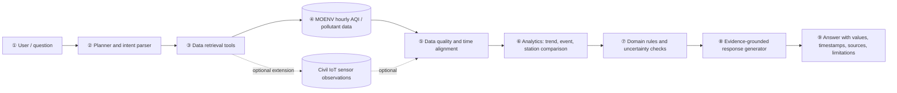
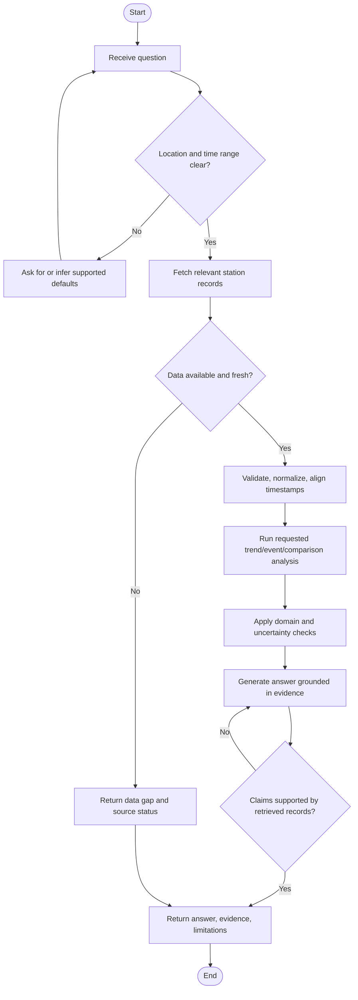

# Taiwan Air Quality Evidence Agent — Proposal (Working Draft)

> Proposal working draft. Research claims and historical-data access still need source-level verification before submission.

## Working title

**Taiwan Air Quality Evidence Agent: An Explainable Agent for Local Pollution Event Analysis**

中文暫定題目：**台灣空氣品質證據分析代理人：結合逐時監測資料的污染事件解讀與情境化資訊系統**

## Abstract

### A. Attention Getter — Motivation

Air-quality information is useful only when people can connect it to a place, time, pollutant, and trustworthy evidence. Taiwan’s Ministry of Environment publishes hourly station-level AQI and pollutant observations, including PM2.5, PM10, ozone, nitrogen oxides, wind, station coordinates, and publication time. The platform provides a historical AQI dataset (AQX_P_488) and a separate current AQI dataset (AQX_P_432). Taiwan also operates a complementary air-pollution IoT sensor network that reports PM2.5, temperature, and relative humidity at finer temporal intervals.

### B. But — Challenge

Raw observations are distributed across stations and time periods, while summary indices can hide which pollutant drives a reading and how nearby measurements differ. Low-cost sensor observations also require cautious interpretation: recent field studies report that humidity and deployment conditions can affect PM sensor accuracy, and calibration performance may not transfer uniformly between pollutants or sites. A plain-language answer that does not expose its data, time window, and uncertainty can therefore be misleading.

### C. Cure — Proposed Solution

This project proposes a **Taiwan Air Quality Evidence Agent** that answers location- and time-specific questions by retrieving official monitoring data, detecting notable changes or cross-station differences, and returning a concise explanation with source, timestamp, pollutant evidence, and limitations.

### D. Development — Method

The system will use the Ministry of Environment’s hourly historical AQI dataset (AQX_P_488) as its primary evaluation source and the current AQI dataset (AQX_P_432) for a live-data demonstration. A data pipeline will validate timestamps and values, align observations by station and hour, and derive trends and event features. A planner will select retrieval and analysis tools based on the user’s question. Domain rules will explain AQI categories and pollutant-specific context; an LLM may turn verified tool results into a readable response but will not invent measurements or make unsupported medical claims. Fine-grained Civil IoT observations may be added as a secondary comparison source if data access and quality checks are feasible.

### E. Experiments — Evaluation

The evaluation will use observations from AQX_P_488 over a selected period and a small set of documented air-quality episodes. We will compare event/trend detection with simple baselines (threshold rules and persistence), report appropriate time-series and classification metrics, and audit answer grounding against retrieved records. We will also test data gaps, conflicting readings, and questions outside the supported evidence.

### F. Findings — Expected Outcomes

We expect to deliver a reproducible pipeline and an evidence-grounded agent that makes official station data easier to interpret. The project will measure when automated summaries are reliable, identify failure cases caused by missing or inconsistent observations, and document whether higher-frequency IoT data adds useful local context. No performance result is claimed before experiments are run.

## 1. Introduction

### A. Motivation

The Ministry of Environment provides an hourly historical AQI dataset, AQX_P_488, and a separate current hourly AQI dataset, AQX_P_432. The historical dataset lists station, pollutant, wind, location, and publication-time fields and provides historical downloadable archives. Its environmental information platform also describes a complementary network of air-pollution sensors with observations such as PM2.5, temperature, and relative humidity. These public sources create a practical basis for a Taiwan-focused data-analysis project.

### B. Background

Air-quality interpretation spans several connected concepts: pollutant-specific measurement, station placement, temporal aggregation, meteorological context, data quality, and communication of uncertainty. AQI is a useful summary, but interpreting a local event may also require inspecting the pollutant sub-index or concentration, recent trend, nearby stations, and data freshness.

### C. Problem Statement

Given a user’s place and time window, how can a system turn public station observations into an understandable, traceable account of what changed, which pollutant or stations contributed to the event, and how certain the interpretation is?

### D. Existing Limitations to Investigate

1. A single AQI value may not explain the pollutant or temporal pattern behind it.
2. Station-level summaries may conceal nearby spatial differences and missing observations.
3. A low-cost sensor network can improve temporal or spatial detail, but sensor behavior and calibration conditions must be made explicit.
4. General-purpose chat interfaces can produce fluent explanations without showing which records support each claim.

These are working hypotheses to validate through the related-work review and source-data inspection.

### E. Innovation

The proposed contribution is an evidence-first agent workflow: every reported measurement or trend is tied to a retrieved station record and time window; uncertainty and missingness are surfaced; and domain rules constrain the natural-language explanation. The project studies whether this tool-using design is more reliable and useful than a static AQI display or an ungrounded text response.

### F. Expected Contributions

1. A documented pipeline for retrieving, validating, and aligning Taiwan air-quality observations.
2. An agent architecture that routes questions to retrieval, temporal analysis, station comparison, and domain-explanation tools.
3. A small benchmark of answerable questions and pollution-event cases with evidence-grounding checks.
4. An evaluation of simple event-analysis baselines and failure cases, including the value and limits of finer-resolution sensor data if it can be integrated.

## 2. Related Work

This section is intentionally incomplete pending a verified literature table. It will be balanced across (1) AI/data methods such as time-series anomaly detection, forecasting, retrieval-grounded generation, and uncertainty communication, and (2) domain knowledge such as AQI interpretation, reference versus low-cost monitoring, meteorological effects, sensor calibration, and data quality.

### Initial article-summary table

| Ref. | Year | Problem | Method / domain knowledge | Dataset | Findings | Limitation relevant to this project |
|---|---:|---|---|---|---|---|
| [1] Fang et al., *Science of the Total Environment*, DOI: 10.1016/j.scitotenv.2025.180106 | 2025 | Real-world influences on low-cost PM2.5 sensor calibration | Field evaluation of humidity, temperature, deployment duration, and concentration | Low-cost monitor measurements paired with reference measurements | Reports humidity-related calibration changes and reduced reliability with longer deployment | Calibration is sensor- and deployment-dependent; findings should not be assumed universal |
| [2] *Calibration and validation-based assessment of low-cost air quality sensors*, DOI: 10.1016/j.scitotenv.2025.179364 | 2025 | Accuracy, stability, and precision of low-cost sensors | Calibration/validation workflow; linear, nonlinear, and ML methods; Bland–Altman analysis | Paired low-cost and reference monitor observations | Highlights the need for validation and cautious use of ML calibration | Results depend on pollutants, sensors, and site conditions |
| [3] *Exploration of a practical approach to providing RH corrections to low cost sensor networks*, npj Climate and Atmospheric Science 8, 227 | 2025 | Humidity-driven discrepancies in low-cost PM2.5 readings | Relative-humidity correction for low-cost sensor networks | Study-specific network observations | Examines practical correction strategies for RH effects | Correction transferability and local aerosol conditions need consideration |

### Synthesis to complete

**Existing research → limitations → research gap → our project:** prior work establishes public air monitoring, low-cost sensor correction, and forecasting/anomaly methods. The review will determine whether a Taiwan-focused system can combine source traceability, station/time-aware explanations, data-quality checks, and domain constraints in one evaluated agent workflow. This gap statement is provisional until the literature search is completed.

## 3. Deep Research

### Q1. Five candidate expert mindsets (to substantiate with sources)

1. **Measurement before interpretation:** sensor readings are observations with instrument and siting context, not ground truth without qualification.
2. **Pollutant-specific reasoning:** AQI is an aggregate; identify the pollutant and averaging window that drive the interpretation.
3. **Time and place matter:** compare like time windows and account for station locations, local variability, and data freshness.
4. **Meteorology changes both pollution and measurement:** wind affects dispersion and transport; humidity and temperature can affect low-cost sensor response.
5. **Communicate uncertainty and action scope:** distinguish observed values, inferred explanations, and precautionary information; avoid causal or medical claims unsupported by data.

Each mindset will be supported with peer-reviewed and authoritative domain sources and mapped to explicit system requirements.

### Q2. Three candidate controversies

1. **Reference stations versus dense low-cost networks:** regulatory-grade accuracy versus coverage and cost. Compare evidence about calibration, representativeness, and spatial coverage.
2. **Simple correction models versus machine learning:** interpretability and transferability versus nonlinear fit. Compare validation design and out-of-site performance, not only in-sample scores.
3. **AQI summary versus pollutant- and exposure-specific communication:** simplicity versus context and uncertainty. Review how aggregation, averaging windows, and health communication affect decision usefulness.

For each controversy, the final submission will present both positions, strongest evidence, current consensus, and unresolved questions.

### Q3. Ten deep-understanding questions

1. Why can two stations report different PM2.5 values at the same hour even when both are functioning correctly?
2. What can and cannot be inferred from an AQI value when the dominant pollutant and averaging period are omitted?
3. What if a low-cost sensor reports a sharp PM2.5 spike during very high relative humidity while a nearby reference station does not?
4. What trade-off arises when correcting low-cost sensor readings with a model trained at only one reference site?
5. What evidence would distinguish a true pollution event from sensor drift, missingness, or a transmission artifact?
6. How should a station comparison change when one station has substantially older observations?
7. When is a simple threshold or persistence baseline preferable to a more complex forecasting model?
8. What failure case would make a language model’s otherwise fluent air-quality answer unsafe or misleading?
9. How should the agent respond when official and IoT sources disagree or use different time intervals?
10. Which evidence and uncertainty should be shown before recommending that a user alter an outdoor activity?

## 4. Proposed Scheme

### 4.1 User and application scenario

Users ask questions such as “How did PM2.5 change in [county/station] over the last 12 hours?”, “Which nearby station had the clearest increase?”, or “What evidence supports the current air-quality summary?” The system provides informational analysis, not diagnosis or individualized medical advice.

### 4.2 System architecture



### 4.3 Module descriptions

1. **User/Application:** accepts a location, time range, pollutant, or interpretive question.
2. **Planner:** identifies the request type and selects supported retrieval and analytics tools.
3. **Retrieval tools:** query the official API or archived extracts; optional sensor retrieval is a later extension.
4. **Primary data source:** MOENV hourly historical AQI dataset (AQX_P_488); current AQI dataset (AQX_P_432) supports a live demonstration. Programmatic historical retrieval and API limits will be verified during implementation planning.
5. **Data quality:** validates units, timestamps, missing/sentinel values, duplicates, and station identity; reports data freshness.
6. **Analytics:** calculates trends, threshold/persistence-based events, and station comparisons; any model is compared with a simple baseline.
7. **Domain rules:** applies pollutant/time-window definitions and guards against overclaiming causal or health effects.
8. **Response generator:** formats verified tool output; measurements and claims must retain provenance.
9. **Output:** concise explanation with source, timestamp, relevant values, uncertainty, and a limitation when evidence is incomplete.

### 4.4 Flowchart



### 4.5 Pseudocode

```text
Algorithm 1: Taiwan Air Quality Evidence Agent
Input : User question Q
Output: Evidence-grounded answer R

01: intent, place, time_window, pollutant ← parse(Q)
02: if required place or time is unresolved then request clarification or use an explicit default
03: stations ← select_supported_stations(place)
04: records ← retrieve_MOENV_hourly_data(stations, time_window)
05: if records are empty then return data_unavailable_response(records.source_status)
06: records ← normalize_units_and_timestamps(records)
07: quality ← validate_missingness_duplicates_freshness(records)
08: if quality indicates insufficient evidence then return limitation_response(quality)
09: features ← compute_requested_trends_events_or_station_comparison(records, pollutant)
10: result ← compare_with_simple_baseline_if_prediction_or_event_detection(features)
11: interpretation ← apply_domain_rules(features, result, quality)
12: claims ← generate_claims_from_retrieved_values(interpretation)
13: claims ← remove_or_qualify_claims_without_evidence(claims, records)
14: R ← format_answer_with_values_timestamps_sources_uncertainty_and_limits(claims)
15: return R
```

### 4.6 Evaluation plan

- **Data QA:** completeness, timestamp validity, duplicate rate, and source freshness.
- **Event/trend analysis:** compare against threshold and persistence baselines; report precision, recall, F1 for event labels if labels can be defined consistently, and MAE/RMSE for forecasting only if forecasting remains in scope.
- **Grounding:** verify whether cited stations, timestamps, values, and dominant-pollutant claims match retrieved records.
- **Robustness:** missing intervals, stale data, conflicting stations, and unsupported questions.
- **User usefulness (optional):** small rubric-based review of clarity, evidence visibility, and uncertainty communication.

## 5. References (initial; verify citation details before submission)

[1] Ministry of Environment, Taiwan, “Air Quality Index (AQI), historical data, dataset AQX_P_488,” https://data.moenv.gov.tw/dataset/detail/aqx_p_488.

[2] Ministry of Environment, Taiwan, “Air Quality Index (AQI), current data, dataset AQX_P_432,” https://data.moenv.gov.tw/dataset/detail/aqx_p_432.

[3] Ministry of Environment, Taiwan, “Air pollution sensing IoT,” https://env.moenv.gov.tw/en/Issue/Index/53b6ae55-bb69-449e-953e-01c2330ca3b8.

[4] R. Fang et al., “Assessing the impact of real-world environmental factors on low-cost PM2.5 monitor performance by comparing calibration before and after deployment,” *Science of the Total Environment*, 995 (2025), 180106. https://doi.org/10.1016/j.scitotenv.2025.180106.

[5] “Calibration and validation-based assessment of low-cost air quality sensors,” *Science of the Total Environment* (2025), 179364. https://doi.org/10.1016/j.scitotenv.2025.179364.

[6] “Exploration of a practical approach to providing RH corrections to low cost sensor networks,” *npj Climate and Atmospheric Science*, 8 (2025), 227. https://doi.org/10.1038/s41612-025-01115-8.
